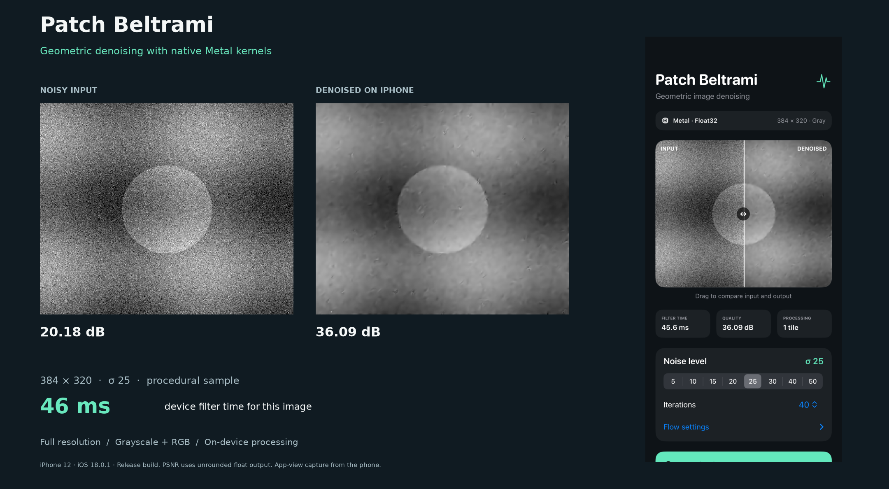
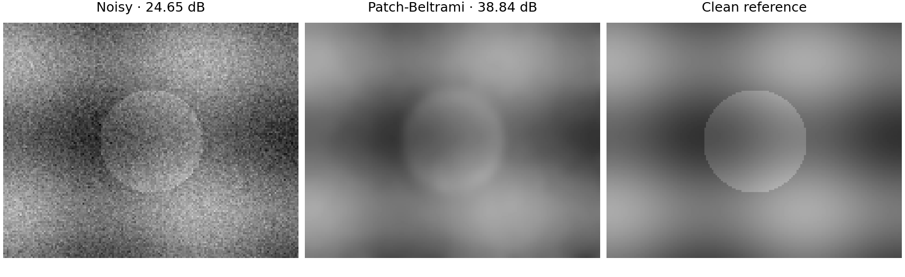

# Beltrami denoising

[](pyproject.toml)
[](ios/README.md)
[](LICENSE)



Python implementations and reproducible experiments for **Efficient Beltrami
Flow in Patch-Space** and the **Deep Patch-Beltrami** models from Aaron Wetzler's
2017 PhD thesis. Runs on Linux with NumPy/SciPy; neural inference uses PyTorch.
MATLAB and Caffe are not required.



## iPhone app

A native SwiftUI app processes grayscale and RGB images with optimized Metal
kernels, full-resolution photo import and a draggable before/after view.
On the tested **iPhone 12**, 256×256 grayscale / 40 iterations took **16.44 ms**
(median of three warm runs). Exact tiling supports larger images within a
192 MiB GPU workspace budget; a 4032×3024 grayscale check completed without
resizing. Latency depends on image size and iteration count.

Open `ios/BeltramiApp.xcodeproj` in **Xcode 16.1+**, choose your Apple signing
team and an **iOS 18+** iPhone, then Run. No model downloads are needed.

```bash
# Optional command-line Release build; use your Apple development team.
TEAM_ID=YOUR_TEAM_ID ios/scripts/build_ios.sh
```

[Installation, controls and measured performance](ios/README.md) ·
[Numerical validation](ios/VALIDATION.md) ·
[Device benchmark record](ios/benchmarks/iphone12.json)

The screenshot and images above come from the app on a physical iPhone and a
procedural sample. The Metal port is float32; the historical paper's
separate double-precision reproduction remains available below.

## Quick start

Python 3.10 or newer:

```bash
git clone https://github.com/twerdster/beltrami-denoising.git
cd beltrami-denoising
python3 -m venv .venv
source .venv/bin/activate
python -m pip install -e .

# A small, deterministic example; no downloads required.
beltrami demo
```

The demo writes a comparison PNG, full-precision arrays and metrics to
`results/demo/`. Its synthetic image improves from **24.65 to 38.84 dB**.

## Reproduce the image paper

```bash
beltrami ssvm --download
```

This downloads seven hash-verified benchmark images from the BM3D authors'
public website, runs the experiments, and checks every result against the
paper's printed values. Reports are saved under `results/ssvm/`. CPU execution
is sufficient; the complete suite includes a parameter search and takes longer
than the demo.

| Experiment | Verified results | Acceptance |
| --- | ---: | --- |
| Table 1: patch size / iteration study | 20 / 20 | All round to the published two decimals |
| Table 3: Patch-Beltrami, regular Beltrami and NLM | 36 / 36 | All round to the published two decimals |
| Three color examples | 3 / 3 | All round to the quoted two decimals |

Table 1 optimizes beta separately against the **clean reference**, as specified
in its caption. It is an oracle study. Table 3 and the color examples use fixed
historical parameters, with no new fitting. The recovered legacy noise sequence
has float32 quantization uncertainty; agreement at printed precision does not
imply bit-identical recovery of the original random doubles.

```bash
# Run the fixed-parameter comparisons only.
beltrami ssvm --download --tables 3 color

# Keep full numerical predictions in addition to the metric reports.
beltrami ssvm --download --save-arrays --output results/ssvm-arrays
```

The paper was presented at **SSVM 2011**; the Springer proceedings carry a
**2012** publication date. [Paper](https://doi.org/10.1007/978-3-642-24785-9_12)
· [Author PDF](https://www.cs.technion.ac.il/wp-content/ron-kimmel/papers/Conference/WetKim_SSVM2011.pdf)

## Reproduce Deep Patch-Beltrami

```bash
python -m pip install -e '.[deep]'
beltrami-deep reproduce bsd68 --output results/deep-bsd68.json
```

The command downloads the original learned tensors, a noise-only fixture and
the 68 public BSD68 images. It verifies all file hashes, reconstructs all
**544 original noisy inputs** exactly, performs inference, and checks all eight
means in **thesis Table 4.6**. Downloads are about 400 MiB plus the clean PNGs.
CUDA is selected when available; `--device cpu` runs without a GPU.

| Noise sigma | 5 | 10 | 15 | 20 | 25 | 30 | 40 | 50 |
| --- | ---: | ---: | ---: | ---: | ---: | ---: | ---: | ---: |
| Thesis PSNR, dB | 37.70 | 33.52 | 31.37 | 29.92 | 28.87 | 28.04 | 26.81 | 25.95 |

These are the saved **40,000-step** checkpoints, although the thesis describes
100,000 steps. The historical grayscale wrapper's intensity offsets are
preserved. No training is needed. The portrait table requires separately
supplied data; the original portraits are not distributed.

[Deep reproduction guide](docs/deep-reproduction.md) covers input conventions,
offline use, smoke tests, per-image validation, model provenance and the
100-versus-92 portrait discrepancy. The deep method is cited to the thesis;
this repository does not identify a separate peer-reviewed Deep Beltrami paper.

## Denoise your own data

```bash
# Classical grayscale or RGB flow. Numerical input/output use the 0–255 scale.
beltrami denoise noisy.png filtered.npy --beta 800 --iterations 40 \
  --radius 2 --preview filtered.png

# The original learned model; sigma is on the 0–255 scale.
beltrami-deep denoise noisy.png filtered-deep.png --sigma 25

# Point cloud as an N×3 NumPy array; sigma uses coordinate units.
beltrami-points noisy-points.npy filtered-points.npy --noise-std 0.01
```

Classical beta is a method parameter, not the noise standard deviation. Choose
it for the intended application. `.npy` output retains floating-point values;
PNG previews are clipped and rounded for display. The library API is also
available:

```python
from beltrami.classical import patch_beltrami

estimate = patch_beltrami(noisy_array, beta=800, alpha=0.21,
                         iterations=40, ws=2, backend="integral",
                         variant="efficient")
```

The point-cloud implementation uses local surface fits and normals estimated
from noisy points. [Its guide](docs/POINT_CLOUDS.md) explains the scope and
parameters. Historical 3D figures are **not claimed as exactly reproduced**:
their complete noise/parameter provenance was not recovered.

## Verification and scope

```bash
python -m pip install -e '.[test]'
python -m pytest
```

Tests cover numerical reference arrays, boundary conditions, noise ordering,
input integrity and command-line behavior. Full paper and thesis experiments
are explicit commands, separate from the quick test suite.
The [verified result files](docs/results/) retain all 59 classical scores and
all 544 Deep BSD68 case scores, input hashes and published-precision checks.

[Reproducibility notes](docs/REPRODUCIBILITY.md) describe precision, clipping,
parameter selection, historical inconsistencies and the limits of comparison
with modern denoisers. This release focuses on the Beltrami methods. External
modern architectures and weights are obtained from their respective projects.

## Citation

Please cite the relevant research when using these implementations. Complete
BibTeX entries are in [references.bib](references.bib).

> Aaron Wetzler and Ron Kimmel. **Efficient Beltrami Flow in Patch-Space.**
> Scale Space and Variational Methods in Computer Vision (SSVM 2011),
> LNCS 6667, pp. 134–143. Springer, 2012.
> doi: [10.1007/978-3-642-24785-9_12](https://doi.org/10.1007/978-3-642-24785-9_12).

> Aaron Wetzler. **Topics in Computational Geometric Vision.**
> PhD thesis, Technion – Israel Institute of Technology, 2017.
> Chapter 4, especially §4.5 and Tables 4.5–4.6 for Deep Patch-Beltrami.

> Aaron Wetzler, Guy Rosman and Ron Kimmel. **Patch-space Beltrami denoising of
> 3D point clouds.** IEEEI, 2012, pp. 1–5.
> doi: [10.1109/EEEI.2012.6377024](https://doi.org/10.1109/EEEI.2012.6377024).

## License

The code is available under the [MIT license](LICENSE). The author's released
Deep Patch-Beltrami tensors include an MIT license in their archive. Benchmark
photographs, external datasets, papers and third-party software retain their
own terms; no benchmark photographs or private portraits are bundled.
See [attribution and external materials](THIRD_PARTY_NOTICES.md).
